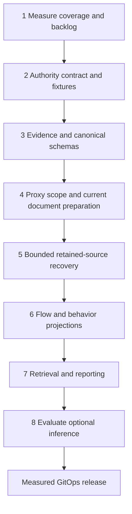

# Proxy-only RAG and ML implementation workmap

> **Status: Stages 1-4 application code implemented; live capacity/backend acceptance pending.** Source review:
> 2026-10-19. Parent commit `99ed0dfbed057ac1fd2c574bcedbb338f90c85bc`;
> Integration Console `6a648e8ecb6e84cb029e738b5df7409f6aee7797`;
> Octopus `c8d603ed015ea71484f06ca4dcb874d23b3d5d10`.
> Production counts, deployed processor state, model artifact behavior and
> retained production coverage remain unavailable. See the
> [implementation record](../ops/sql/proxy-rag-measurements.md#implementation-record-2026-10-19).
> Stage 3/4 code, verification and open activation gates are recorded in the
> [evidence and preparation implementation record](../docs/proxy-rag-evidence-preparation.md).

## Execution contract

- Read [root instructions](../AGENTS.md), [service instructions](../services/AGENTS.md),
  [Octopus instructions](../services/octopus/AGENTS.md), and
  [Search instructions](../apps/integration-console/atheros-search/AGENTS.md)
  before their respective changes. Recheck deeper instructions and worktree state.
- Implement the eight stages below in order. Contract design and test fixtures
  can overlap; activation and recovery must respect every prerequisite gate.
- Update task checkboxes and attach command results, source revisions, measured
  outcomes and unresolved limitations to each implementation change.
- Preserve unrelated edits. The parent, Octopus and Integration Console are
  separate Git repositories; review their diffs and record compatible gitlinks.
- Reconcile overlap with the existing [Search quality workmap](001-atheros-search-performance-quality-workmap.md)
  and [reporting plans](../plans/README.md). Their recorded production and dirty
  workspace observations are historical, not current facts.
- Use reviewed Git changes, pinned images and Argo CD for rollout. This plan
  authorizes no direct mutation of managed Kubernetes resources.
- For drift checks, run `git diff --stat 99ed0df..HEAD -- src crates/sync-plane sql/postgres ops/sql cyber-stack scripts`
  in the parent; compare Octopus against `c8d603e` and Integration Console against
  `6a648e8` inside those repositories. Resolve changed assumptions before editing.

## Ownership and invariant checklist

| Owner | Allowed responsibilities | Boundary |
| --- | --- | --- |
| Rust proxy and sync-plane | Observations, additive source evidence, existing sync publication | No database client or independent embedding pipeline |
| Octopus | Durable ingestion/dedupe, normalization, documents/jobs, reconciliation, behavioral and similarity projections, signal/alert derivation | External model calls stay outside database transactions |
| Go Atheros Search | Fenced embedding execution, retrieval/ranking, reporting APIs and ETL health | Consume published Search-domain evidence; no projection maintenance or direct private proxy/registration reads |
| Canonical manifests and provisioning executor | Append-only DDL, indexes, grants, checksums and schema readiness | No runtime DDL, stored routines, triggers, materialized views or alternative database |

- [ ] Keep existing stream/topic meanings, source IDs and retained replay evidence.
- [ ] Keep taxonomy: `ads_tracker`, `analytics`, `cdn`, `essential_api`, `auth`, `unknown`.
- [ ] Keep `nomic-embed-text-v2-moe`, 768 dimensions and tokenizer-based budgeting.
- [ ] Keep exact normalized-text SHA-256 distinct from raw-payload checksums.
- [ ] Keep deterministic document/job identities, supersession, lease token/fence/expiry checks and atomic unified/per-kind vector completion.
- [ ] Keep old API behavior, including substring host matching; introduce kinds and fields additively.
- [ ] Keep raw keys, client addresses and user-identifying values out of embedding text and exported diagnostics.
- [ ] Keep observed events, validated flows, coalesced attempts, transfer measurements and blocked-byte estimates distinct.
- [ ] Keep ClientHello offers distinct from negotiated TLS and statistical findings distinct from confirmed threats.
- [ ] Use existing Octopus preparation and Go workers for recovery; no bulk processor-state resets or standalone document inserts.

## Source evidence and current gaps

Line numbers are review coordinates at the revisions above. Proposed behavior
appears in the task tables, not as a claim of an existing capability.

| Ref | Current evidence | Consequence |
| --- | --- | --- |
| SRC01 | [Sync contract](../crates/sync-plane/src/contract.rs), line 10; [proxy event allowlist](../src/proxy_sync.rs), line 5; [event publication](../src/events.rs), lines 236-289 | Replay retained envelopes and source identities through existing ingestion; newly emitting an equivalent event is not replay |
| SRC02 | [HTTP proxy](../src/proxy.rs), lines 139, 427; [CONNECT](../src/tunnel/connect.rs), lines 35, 136; [QUIC requests](../src/quic_sections/requests.rs), line 114; [transparent listener](../src/tunnel/transparent_sections/listener.rs), line 294 | Some paths discard authority/explicit port; transparent IPv6 authority formatting is ambiguous |
| SRC03 | [Event emission](../src/events.rs), lines 138, 155, 199; [coalescing state](../src/state_sections/models.rs), line 135; [coalescing implementation](../src/state_sections/app_state.rs), lines 65-95 | Blocked events may be suppressed within 500 ms; retained counts do not establish attempts, and sanitized hosts lack an explicit status |
| SRC04 | [Audit context](../src/tunnel/audit_event.rs), lines 68-162; [CONNECT copy paths](../src/tunnel/connect.rs), lines 253-279, 421-465; [transparent bypass](../src/tunnel/transparent_sections/decisions.rs), line 233 | Opens carry zero counters; error paths can replace partial totals with zeros or count an unsuccessfully written prefix |
| SRC05 | [Identity resolution](../src/identity.rs), lines 11, 73-84; [claim validity](../src/state_sections/app_state.rs), lines 491-512; [TLS parser](../src/tunnel/tls.rs), lines 1, 226-232 | Registration methods/validity are not fully emitted; TLS fields describe ClientHello offers |
| SRC06 | [Durable proxy schema](../sql/postgres/octopus_core/01_tables/004_proxy_sink.sql), lines 4-29; [compatibility fields and rollups](../sql/postgres/octopus_core/01_tables/010_legacy_sinks_and_leases.sql), lines 160, 324; [transforms](../services/octopus/src/main/scala/com/sslproxy/coordinator/postgres/PostgresTransformService.scala), lines 61-130 | Required host and default-zero counters need additive evidence/availability contracts; retained JSON may preserve some missing scalar fields |
| SRC07 | [Proxy source candidates](../services/octopus/src/main/scala/com/sslproxy/coordinator/postgres/sql/SearchPreparationSql.scala), lines 311-455 | Event candidates select absent documents only; text includes device identity; blocked windows aggregate retained history before LIMIT |
| SRC08 | [Document preparation](../services/octopus/src/main/scala/com/sslproxy/coordinator/processor/SearchDocumentPreparation.scala), lines 18, 82-149; [document persistence](../services/octopus/src/main/scala/com/sslproxy/coordinator/postgres/sql/SearchPreparationSql.scala), lines 520-623 | Exact normalized text determines checksum/identity; supersession, lexical/tokens/tags and jobs already exist; generic NFKC is not authority parsing |
| SRC09 | [Shared preparation](../services/octopus/src/main/scala/com/sslproxy/coordinator/postgres/PostgresRepository.scala), lines 672-723; [processor catalog](../services/octopus/src/main/scala/com/sslproxy/coordinator/processor/ProcessorId.scala), lines 105, 301-349; [supervisor](../services/octopus/src/main/scala/com/sslproxy/coordinator/processor/ProcessorSupervisor.scala), line 333 | Shared preparation includes wireless kinds; text builder depends on wireless inventory; consumer enablement unions additional IDs |
| SRC10 | [Threat scheduler](../services/octopus/src/main/scala/com/sslproxy/coordinator/cron/CronScheduler.scala), line 193; [scoring](../services/octopus/src/main/scala/com/sslproxy/coordinator/processor/IntelligencePreparation.scala), line 318; [threat SQL](../services/octopus/src/main/scala/com/sslproxy/coordinator/postgres/sql/ThreatRiskSql.scala), lines 8-35; [rollup upsert](../services/octopus/src/main/scala/com/sslproxy/coordinator/postgres/sql/BatchSinkSql.scala), lines 31-47 | Shared threat execution includes wireless risk; intensity needs calibration; stale signals and event-time latest fields need correction |
| SRC11 | [Similarity candidates](../services/octopus/src/main/scala/com/sslproxy/coordinator/postgres/sql/IntelligenceSql.scala), line 239; [similarity scan state](../sql/postgres/atheros_search/01_tables/014_similarity_scan_state.sql) | Shared event vectors do not imply proxy scope; anchors, candidates and progress require explicit scoping |
| SRC12 | [Proxy document schema](../sql/postgres/atheros_search/01_tables/012_proxy_search_documents.sql), lines 18-49; [job uniqueness](../sql/postgres/atheros_search/01_tables/002_search_documents.sql), lines 44-65; [recovery contract](../sql/postgres/atheros_search/01_tables/009_embedding_recovery_contract.sql), lines 47-78; [unified vectors](../sql/postgres/atheros_search/01_tables/003_search_vectors.sql), lines 4-15 | Only two proxy kinds are admitted; current unique keys do not represent independent preprocessing revisions |
| SRC13 | [Worker claims/recovery](../apps/integration-console/atheros-search/internal/worker/lease.go), lines 15-71, 294-365; [worker transaction boundaries](../apps/integration-console/atheros-search/internal/worker/worker.go), lines 160-174, 289-325 | Claims/recovery are shared; job text attachment lacks checksum comparison; model I/O is already outside claim/completion transactions |
| SRC14 | [Embedding client](../apps/integration-console/atheros-search/internal/embed/client.go), lines 207-350; [token budget](../apps/integration-console/atheros-search/internal/embed/tokens.go), line 11; [query text](../apps/integration-console/atheros-search/internal/search/text_builder.go), line 143; [cache](../apps/integration-console/atheros-search/internal/embed/cache.go), line 39 | Client ignores embedding kind and sends chunk text; no explicit model-card prefix is applied here; backend behavior remains unmeasured; zero-norm rejection needs strengthening |
| SRC15 | [Dense retrieval](../apps/integration-console/atheros-search/internal/search/dense.go), lines 22-32, 138-167; [shared SQL scope](../apps/integration-console/atheros-search/internal/queryscope/scope.go), line 63; [result filters](../apps/integration-console/atheros-search/internal/search/filters.go), line 32; [fusion](../apps/integration-console/atheros-search/internal/search/fusion.go), line 7 | Proxy kinds share event embeddings; substring host behavior must survive; dense eligibility needs current-content/preprocessing matching |
| SRC16 | [ETL health](../apps/integration-console/atheros-search/internal/etlhealth/health.go), lines 248-261, 359-375; [repair](../apps/integration-console/atheros-search/internal/app/repair/repair.go), lines 115, 238-261; [record context](../apps/integration-console/atheros-search/internal/search/record_context.go), lines 61, 354 | Health is not proxy coverage; some repair operations lack scope/batch limits; proxy context is not an implemented timeline |
| SRC17 | [Search grants](../sql/postgres/atheros_search/grants/least_privilege.sql.tmpl), lines 16-45; [core grants](../sql/postgres/octopus_core/grants/least_privilege.sql.tmpl), line 78; [executor](../k8s/postgres-schema-executor/entrypoint.sh), lines 120-146, 403-413 | Publish safe evidence into Search domain; table-specific grants and checksum readiness are release prerequisites |
| SRC18 | [Broker-drain desired profile](../cyber-stack/matrix/prod/patches/java-coordinator-broker-drain.yaml), lines 11-23; [Go deployment](../cyber-stack/base/atheros-search/deployment.yaml), lines 81-119; [production Go patch](../cyber-stack/matrix/prod/patches/atheros-search.yaml) | Desired configuration is evidence of intent, not live enablement or capacity |
| SRC19 | [Lifecycle audit](../ops/sql/proxy-tunnel-completeness.sql), lines 4-40; [maintenance receipts](../sql/postgres/octopus_core/01_tables/012_retention_and_reconciliation_runs.sql); [proxy source indexes](../sql/postgres/octopus_core/01_tables/013_proxy_search_indexes.sql) | Extend measurement tooling; current lifecycle grouping spans retained history before filtering the requested range |
| SRC20 | [Go contract runner](../scripts/tests/test_atheros_reporting.py), lines 44-111; [executor integration](../scripts/tests/test-postgres-schema-executor-integration.sh); [Scala canonical integration](../services/octopus/src/test/scala/com/sslproxy/coordinator/ingest/OctopusPersistenceIntegrationSuite.scala), lines 88, 2313 | Canonical DDL, actual grants and ephemeral pgvector tests already have reusable harnesses |
| SRC21 | [Periodic processor scheduling](../services/octopus/src/main/scala/com/sslproxy/coordinator/cron/CronScheduler.scala), lines 214-233; [document supersession/upsert](../services/octopus/src/main/scala/com/sslproxy/coordinator/postgres/sql/SearchPreparationSql.scala), lines 520-554 | The operation ignores the claimed lease argument; document persistence can supersede another active version and reactivate an older document without a source-revision comparison |

Current excerpts to preserve or replace deliberately:

SRC01-SRC07 received a further implementation and regression pass on 2026-10-24.
See the [source-evidence follow-up](../docs/proxy-rag-evidence-preparation.md#src01-src07-follow-up-2026-10-24)
for retained-envelope replay, cancellation counters, ClientHello offers,
measurement provenance and correction invalidation. These are local acceptance
results; production activation and recovery gates remain open.

```text
SearchDocumentPreparation.scala:87-91
  checksum = sha256Hex(normalizedText.getBytes(UTF_8))
  noncompact identity = stableUuid(sourceTable + ":" + sourceKey + ":" + checksum)

SearchPreparationSql.scala:335
  WHERE document.document_id IS NULL

worker/lease.go:17-25
  WHERE status = 'pending' AND next_attempt_at <= CURRENT_TIMESTAMP
    AND attempt_count < max_attempts
  ORDER BY priority ASC, next_attempt_at ASC, job_id ASC
  FOR UPDATE SKIP LOCKED

embed/client.go:207
  func (c *HTTPClient) Embed(ctx context.Context, texts []string, _ Kind)
```

The identity excerpt is explanatory pseudocode; retain the actual implementation
for existing kinds. New kinds need disjoint deterministic source-key namespaces
because both identity and supersession also use source table/key.

## Master tasklist and dependency map

Effort is a planning range: M = approximately a day, L = several days, XL =
multiple reviewable changes. Estimates include tests, not production drain time.
Stages 1 and 2 have implementation evidence below; M07 and production gates remain open.
No historical count is an acceptance result.

| Stage | Tasks | Outcome | Depends on | Owner | Effort / change risk |
| --- | --- | --- | --- | --- | --- |
| 1 | M01-M07 | Fresh proxy coverage, backlog, availability and capacity baseline | None | Octopus / Go / operations analysis | L / medium |
| 2 | N01-N06 | Versioned Scala/Go authority contract and shared fixtures | Stage 1 | Octopus + Go | L / high |
| 3 | E01-E08, S01-S05 | Preserved endpoint, identity and measurement evidence; canonical schema | Stage 2 | Rust + Octopus + schema | XL / high |
| 4 | P01-P06, D01-D08, V01-V05 | Explicit scope, current document reconciliation and compatible embedding inputs | Stage 3 | Octopus + Go | XL / high |
| 5 | R01-R07 | Bounded retained-source recovery using existing preparation/workers | Stage 4 and canonical database gates | Octopus + Go | L / high |
| 6 | B01-B12 | Validated flows/windows, statistical evidence and scoped similarity | Stage 5 coverage gate | Octopus | XL / high |
| 7 | A01-A08 | Additive retrieval, exact filters, evidence reports and ETL health | Stage 6 published surfaces | Go + schema | XL / medium |
| 8 | Q01-Q07 | Relevance evaluation and optional reranking/grounded-answer decisions | Stage 7 | Go + evaluation | L, optional extensions XL / high |
| Release | L01-L06 | Staged, measured GitOps release with rollback evidence | Per-stage tests; Q01-Q03 before broad search release | All owners | L / high |



## Stage 1: Establish measurements

Scope: SRC06, SRC12-SRC20; extend `ops/sql/` read-only audits and synthetic contract
tests. Proposed new artifact: `ops/sql/proxy-rag-coverage.sql` (create).
Keep full-history scans out of request-time ETL health.

| Done | ID | Action | Acceptance evidence / gate |
| --- | --- | --- | --- |
| [x] | M01 | Record parent/submodule/image revisions, measurement timestamp, retained source range, schema attestations, installed vector extension version, actual processor enablement/dependency closure and worker settings. Distinguish desired Git state from live state. | Dated measurement record with unavailable fields explicitly marked; no secret values; G1, G8 |
| [x] | M02 | Freeze eligibility for all currently allowlisted proxy event types; define excluded/malformed/sanitized/retention-truncated dispositions. Freeze event-to-document identity and job/vector match predicates. | Synthetic source ledger partitions into eligible and named exclusions without double counting; G1, G3 |
| [x] | M03 | Measure source-to-absent-document, source-to-outdated-document, active-document-to-current-job, active-document-to-current-vector, completed-job-to-missing-vector, and unified/per-kind parity separately. | Match document ID, source kind, model, text checksum and available preprocessing identity; unknown legacy preprocessing is a separate bucket; G3, G4 |
| [x] | M04 | Segment stage gaps by event/source kind, age, template/normalization revision, model/preprocessing, checksum and job status. Count failed/exhausted/cancelled dispositions separately. | Reconciled totals with an explicit denominator and cutoff; report historical 175,519 only as unverified historical input; G3 |
| [x] | M05 | Measure attribution coverage, raw/normalized authority availability, explicit-port presence, coalescing status, terminal-byte availability, TLS availability and lifecycle completeness. | Events and validated flows have distinct denominators; null/unavailable never counted as measured zero; G1, G3 |
| [x] | M06 | Bound audit input ranges and keyset pages, scanned rows, output rows and statement time. Fix lifecycle audit to find bounded counterpart evidence across interval boundaries without claiming completeness beyond its search horizon. | EXPLAIN and scanned/returned counts on representative synthetic volume; no full retained aggregation hidden behind LIMIT; explicit cross-boundary unknowns; G3, G4 |
| [ ] | M07 | Measure current-ingest lag, query latency, jobs/sec, tokens/sec, backend errors, DB wait/locks/WAL, queue growth and memory. Set numerical current-traffic reserve, queue headroom, scan/transaction limits and pause thresholds before recovery. | Capacity sheet distinguishes interactive/current/backfill traffic and includes a measured drain estimate; unmeasured values remain release blockers; G8 |

Stage gate: a reproducible read-only measurement artifact and synthetic coverage
tests exist. Live access unavailability does not justify invented counts;
implement measurement tooling first and leave rollout/recovery pending evidence.

M01-M06 checkboxes record tooling and synthetic acceptance, not production
coverage. [Commands, measured fixture counts, revisions and open gates](../ops/sql/proxy-rag-measurements.md#implementation-record-2026-10-19)
are recorded together. M07 remains blocked on actual capacity and reviewed budgets.

## Stage 2: Version authority normalization

Scope: SRC02, SRC06-SRC08, SRC15; pure Scala preparation and Go query normalization.
Proposed shared corpus: `sql/postgres/contracts/fixtures/proxy-authority-v1.json`
(create), loaded by both test suites without a runtime dependency on a checkout.

| Done | ID | Action | Acceptance evidence / gate |
| --- | --- | --- | --- |
| [x] | N01 | Specify `host_raw`, `host_normalized`, explicit `port`, `authority_normalized`, `registrable_domain`, `normalization_version`, `parse_status`, authority source and sanitization status. Keep effective routing port separate. | Contract distinguishes raw authority from host and absence from explicit default ports; G2 |
| [x] | N02 | Choose matching IDNA rules and a pinned PSL revision with an explicit private-suffix policy. Compare existing dependency options before adding a parser/PSL library; do not approximate registrable domains by label splitting. | Decision records Unicode/IDNA behavior, private suffix examples, version/update process and bounded input policy; G2 |
| [x] | N03 | Implement strict authority parsing for DNS/root dots, IPv4, bracketed IPv6, explicit ports and bare IPv6 without inventing a port. Reject/safely classify malformed input, credentials, paths, controls, out-of-range ports and ambiguous unbracketed IPv6. | Invalid input preserves permitted raw evidence but cannot enter exact host/domain grouping as valid; G2 |
| [x] | N04 | Add shared fixtures for `ChatGPT.com:443`, `example.com:8443`, `[2001:db8::1]:443`, `example.co.uk.`, Unicode/punycode pairs, private suffixes, IP literals, sanitized values, missing input and malformed boundaries. | Scala and Go emit identical structured expected values and version for every case; G2, G5 |
| [x] | N05 | Implement pure Scala ingestion/preparation normalization and Go filter normalization using the shared contract; preserve the existing substring host filter path. | Tests cover exact host versus authority/port grouping, deterministic replay and sanitized/unavailable inputs; G2, G5 |
| [x] | N06 | Define normalization migration policy: legacy values remain identifiable; grouping/version changes recompute affected projections and select outdated documents. | Old/new normalization fixtures coexist without overwriting raw observations or mixing grouping identities; G2, G3 |

The [Go PSL API](https://pkg.go.dev/golang.org/x/net/publicsuffix) exposes
registrable-domain calculation. The implemented
[authority decision](../docs/proxy-authority-v1.md) instead bundles identical
pinned PSL data in Scala and Go and validates matching structured output against
61 shared fixtures. Runtime persistence and additive filter wiring remain later stages.

## Stage 3: Preserve evidence and add canonical schema

Implementation and synthetic/canonical checks are complete. The
[implementation record](../docs/proxy-rag-evidence-preparation.md) records exact
commands, compatibility limits and rollout prerequisites; these checkboxes do
not attest a production rollout.

Scope: SRC01-SRC06, SRC12, SRC17. Rust edits stay localized to observations and counting.
Octopus transforms/sinks retain ownership of durable rows. Legacy scalar fields
remain compatible; new fields carry precise semantics.

| Done | ID | Action | Acceptance evidence / gate |
| --- | --- | --- | --- |
| [x] | E01 | Freeze producer fixtures for every emitted proxy type, full retained envelope, event ID/dedupe key, open/close sequence, sanitization and duplicate delivery. | Replay yields unchanged ingestion evidence/source counts; distinct observations retain distinct IDs; G1, G3 |
| [x] | E02 | Preserve bounded raw host/authority and explicitly observed ports in HTTP, CONNECT, QUIC and transparent paths. Format synthesized IPv6 authorities correctly; distinguish SNI, authority, original destination and routing defaults. | All source paths pass shared endpoint cases; original destination evidence cannot be overwritten by SNI; G1, G2 |
| [x] | E03 | Apply existing hostname privacy policy to every new raw/derived host field and nested evidence. Mark sanitization explicitly; no recovery of sanitized DNS by guessing. | Sanitized producer fixtures contain no bypass through a new raw field; G1, G3 |
| [x] | E04 | Emit attribution method, mapping revision, valid interval and scoped opaque peer reference alongside supported registration evidence. Specify reference scope, rotation and expiry without exporting raw keys. | Token versus peer-claim methods, claim expiry, shared addresses, key rotation and unknown identity remain distinguishable; G1, G3 |
| [x] | E05 | Add byte/duration availability, units, direction, completion/termination and measurement-source fields. Separate actual terminal transfer, partial counters, header latency and approximate blocked bytes. | Legacy zero cannot become a confirmed zero; open/header-only/failed-copy observations have explicit availability; G1, G3 |
| [x] | E06 | Correct forwarding counter error paths using successful-write accounting; include prefix bytes exactly once. Preserve partial counts when copy fails; use unavailable status when actual totals cannot be established. | Tests with partial prefix writes, read/write errors, reset, empty transfer and successful bidirectional copy establish counts without changing forwarding semantics; G1 |
| [x] | E07 | Add bounded coalescing evidence/metrics: policy version, window bounds, counter scope, suppressed counts when known, saturation/loss disposition. Do not sum lifetime host counters as device attempts. | Multi-device, reason-change, rollover and full-map tests explain counts; historical attempts remain unknown; G1, G3 |
| [x] | E08 | Preserve ClientHello metadata source/parser revision/status and offered-version/ALPN semantics. Keep `ja3_lite` unchanged and distinguish timeout, parse failure, non-TLS and unavailable fields. | TLS fixtures and report/template terminology never claim negotiated protocol/cipher or JA4; G1, G2 |
| [x] | S01 | Append core evidence and Search-domain evidence/projection migrations; allocate next free ordered filenames after checking concurrent work. Define nullable/explicit unknown legacy states, bounded raw authority length and explicit port constraints. | Existing migration bytes unchanged; fresh and upgrade databases agree; G3, G4 |
| [x] | S02 | Design deterministic identities/source-key namespaces for `proxy_flow`, `proxy_host_window`, later `proxy_device_window` and `proxy_signal`. Admit only release-needed kinds; update source-kind checks and partial indexes together. | Both source uniqueness contracts and supersession cannot collide across kinds; existing identities stay stable; G3, G4 |
| [x] | S03 | Add versioned evidence/preparation/preprocessing fields and necessary unique keys/indexes. Distinguish text revision, evidence revision, normalization revision and embedding input revision; do not use a different model name to hide preprocessing changes. | Same text can refresh structured evidence without unnecessary embedding; preprocessing incompatibility cannot silently reuse a vector; G3, G4 |
| [x] | S04 | Grant Octopus writes and Go read access to exact Search-domain projections/coverage summaries; avoid broad core/registration grants. Define retention and bounded evidence drilldown instead of unbounded event-ID arrays. | Runtime roles can perform their intended operations and are denied private source/credential access and unauthorized writes; G3, G4 |
| [x] | S05 | Update file checksums, domain manifests/versions, consumer expected digests and schema readiness references together. Apply through the provisioning executor and retain fail-closed runtime verification. | Fresh install, upgrade, replay, checksum drift and readiness mismatch tests pass; G4, G6, G7 |

Historical evidence rule: recover fields only from supported retained payloads
with provenance. Missing explicit ports, suppressed attempts, partial byte totals
or attribution validity cannot be reconstructed from defaulted scalar values.

## Stage 4: Scope processors and reconcile current documents

Application paths and their synthetic/canonical checks are implemented.
D07 remains gated by M07 production budgets; V01 remains unmeasured, so V02
prefix activation is still blocked despite passing client-side wire fixtures.
See the [implementation record](../docs/proxy-rag-evidence-preparation.md).

Scope: SRC07-SRC16, SRC21, shared [processor manifest](../sql/postgres/contracts/processors.json),
Octopus config/wiring/features and Go worker/config/app paths. Scope controls
must exist before changing the broker-drain production profile.

| Done | ID | Action | Acceptance evidence / gate |
| --- | --- | --- | --- |
| [x] | P01 | Record an explicit proxy-only dependency closure. Choose scoped shared implementations or dedicated proxy processor IDs; resolve text-builder wireless inventory and shared threat dependencies without weakening validation. | A proxy-only runtime starts with valid dependencies and executes zero wireless preparation/projection queries; G2, G3, G6 |
| [x] | P02 | Update Octopus accepted config/env parsing, catalog, shared manifest, workload wiring and tagged feature scenarios together. Preserve existing wireless configuration behavior. | Invalid/unknown scopes fail startup; feature/catalog/workload contract tests pass; G2, G6 |
| [x] | P03 | Audit schema preflight, shared scheduler, retention, reconciliation, similarity and consumer-union behavior. Distinguish provisioned canonical tables from enabled runtime work; explicitly list any still-enabled wireless consumers. | No hidden wireless projection/readiness processor prerequisite; consumers are not misreported as proxy-only just because a processor list omits them; G2, G3 |
| [x] | P04 | Add explicit Go worker source-kind allowlist through config/app, claims, expired recovery and diagnostics. `embedding_kind=event` is insufficient. Preserve worker opt-in. | Mixed queue test leaves wireless jobs/leases unchanged; proxy selection includes supported proxy kinds only; G3, G5 |
| [x] | P05 | Scope operational repair/status paths; require dry-run, batch limits, model/revision bounds and durable progress for any replay/retry extension. Retain failure history. | Existing broad reset-stale/retry-failed commands are not the recovery runbook; scope/limit tests pass; G3, G5 |
| [x] | P06 | Scope Octopus similarity anchors, candidates, pair identity and scan checkpoints to proxy kinds and compatible normalization/model/preprocessing revisions. | Both-side exclusion tests prevent proxy/wireless pairs; resume cannot skip another scope; G3, G5 |
| [x] | D01 | Version proxy event and blocked-host templates. Use normalized host, classification, outcome/reason, available ClientHello metadata, ALPN and bounded transfer/duration descriptors. | Deterministic golden text fixtures; no raw device IDs, addresses, keys, user identifiers or exact numerical histories in embedding prose; G2, G3 |
| [x] | D02 | Select absent and outdated active documents, including template/normalization/evidence changes and source corrections. Replace whole-history blocked aggregation with bounded dirty-window candidates. | Existing active stale document is repaired; unchanged document is not rebuilt; scan work is bounded before aggregation; G2, G3 |
| [x] | D03 | Retain deterministic normalized-text hashing, source identities, supersession, tokens, tags, lexical vector and cancellation of unfinished old jobs in one transaction. | Repeated replay preserves IDs/counts; changed text supersedes once; old completion cannot restore stale vectors; G3 |
| [x] | D04 | Handle structured-only corrections without forcing text churn. Make detail/window evidence revision and current source watermark visible. | Late correction with identical semantic text refreshes authorized metadata and source evidence without duplicate documents/jobs; G3 |
| [x] | D05 | Reconcile absent jobs, terminal jobs, completed jobs lacking vectors, stale checksums, preprocessing mismatch and unified/per-kind mismatch separately. Use explicit retry/replacement policy through existing owners. | A terminal job is not treated as vector coverage; repairs converge without duplicate unfinished jobs or losing diagnostics; G3, G4 |
| [x] | D06 | Introduce durable advancing scan checkpoints plus late-arrival/dirty-source reconciliation. Event-time alone cannot be the durable arrival cursor. | Crash/resume and older-event-time insertion tests prove no retained eligible source is skipped; G3 |
| [ ] | D07 | Bound total work across kinds, input rows/groups, output changes, transaction duration and queue headroom. Avoid a per-kind LIMIT multiplying one unbounded transaction. | Measured transaction/query plan fits M07 budgets; contention/high-water tests avoid overshoot and preserve current work; G3, G8 |
| [x] | D08 | Carry Octopus preparation/reconciliation ownership into commit transactions and validate the live lease token/fence/expiry. Serialize updates per source/window and compare monotonic source/evidence revisions before supersession, metadata replacement, job enqueueing and checkpoint advancement. A checksum-derived source version is not a monotonic revision. Apply equivalent guards to stage 6 projections/current pointers. | Expired preparation ownership and overlapping old/new work, including identical-text metadata corrections, leave newer documents/evidence/jobs/checkpoints unchanged; no stale reactivation; G2, G3. Required before R02 |
| [ ] | V01 | Measure actual backend artifact/tokenizer/template/pooling/chunking behavior with bounded synthetic query/document probes. Record whether the server inserts task prefixes. | Wire-level test evidence identifies effective inputs without raw user traffic; no production prefix assertion based only on client code; G5, G8 |
| [ ] | V02 | Implement exactly-once query/document prefixes at the verified boundary, including every chunk. Reserve prefix/special-token overhead within the 512-token backend limit. | Query and document fixtures, empty/already-prefixed input, multi-chunk and 480-content-token boundary tests pass without truncating prefix intent; G5 |
| [x] | V03 | Carry artifact/preprocessing identity through jobs, both vector stores, retrieval eligibility and cache keys. Choose explicit compatible coexistence or scoped drain/switch; plan re-embedding for every changed effective document input. | Queries cannot mix incompatible vector spaces; existing wireless vectors are not silently overwritten by a proxy-only migration; G3, G4, G5 |
| [x] | V04 | Reject wrong dimension, nonfinite and zero-norm vectors before pooling, query execution and persistence; validate pooled outputs too. Recompute normalized-text hash and compare job/document/current-vector checksums at attachment and completion. | Malformed backend and mutation/supersession race tests cannot complete a mismatched job or persist an unusable vector; G3, G5 |
| [x] | V05 | Preserve claim commit before model calls, renewals during external work, token/fence/expiry checks and all-or-nothing unified/per-kind completion. Restrict dense retrieval to current content/preprocessing identity. | Stale/expired owner writes roll back both vector stores and completion; transaction-boundary regression tests pass; G3, G5 |

The [Nomic model card](https://huggingface.co/nomic-ai/nomic-embed-text-v2-moe)
specifies query/document prefixes and a 512-token maximum. Its guidance does not
prove what the deployed serving wrapper currently does. Keep the selected
768-dimensional representation fixed. Do not change only query preprocessing
while continuing to search incompatible historical document vectors.

## Stage 5: Recover retained eligible data

Scope: existing Octopus preparation/reconciliation, Go worker/recovery and
read-only measurement surfaces. Production execution depends on release tasks.

| Done | ID | Action | Acceptance evidence / gate |
| --- | --- | --- | --- |
| [ ] | R01 | Freeze campaign scope, retained source bounds, target revisions and baseline M01-M07. Classify permanently absent/expired sources and terminal failures. | Signed-off campaign parameters and explicit nonrecoverable dispositions; no promise to recreate unretained evidence; G3, G8 |
| [ ] | R02 | Replay a small representative retained slice through Octopus preparation, supersession and job enqueueing; consume it with scoped existing Go workers. | Event/ingestion evidence counts remain stable; document/job/vector checksums align; G3 |
| [ ] | R03 | Resume historical keyset slices from durable checkpoints, with transaction and queue caps. Keep late-arrival correction work independent of advancing historical progress. | Crash/restart, same-timestamp sources, deleted source and delayed-arrival cases converge; G3 |
| [ ] | R04 | Reserve measured capacity for fresh traffic and interactive queries; throttle or pause backfill on M07 thresholds. | Current/recovery throughput, lag and query latency recorded independently during drain; G8 |
| [ ] | R05 | Recover expired leases through Go recovery; inspect exhausted/failed/cancelled work by cause. Retry only eligible reviewed scoped failures without resetting processor state. | Stale-owner tests pass; bounded retry cannot revive superseded/orphan work or exhaust current capacity; G3, G5 |
| [ ] | R06 | Repeat the same coverage audit after each batch/campaign checkpoint; reconcile source/doc/job/unified/per-kind differences. | Every eligible source has current coverage or an explicit disposition; completed current jobs have both matching vectors; G3, G4, G8 |
| [ ] | R07 | Replay the completed slice again and compare identities, evidence counts, current projections and jobs. Publish actual recovered counts, retained limits, unresolved failures and remaining drain estimate. | Zero unexplained coverage gaps in the frozen slice; unchanged input produces unchanged durable results; G3, G8 |

No runbook step may replace source reconciliation with SQL document inserts,
global failed-job retries, bulk processor-state deletion or direct cluster edits.

## Stage 6: Build bounded behavioral evidence

Scope: Octopus-owned projections in canonical Search-domain surfaces. Additive
source kinds continue to use the compatible existing `event` embedding kind
initially. Exact evidence stays structured and accessible through bounded pages.

| Done | ID | Action | Acceptance evidence / gate |
| --- | --- | --- | --- |
| [ ] | B01 | Define a validated lifecycle state machine for `proxy_flow`: source identity/correlation scope, open/terminal sequence, pairing horizon, duplicates, conflicting terminals, missing sides and retention truncation. | One supported complete pair is one flow; no sum of open/close counts; incomplete/ambiguous evidence remains visible; G1, G3 |
| [ ] | B02 | Prepare deterministic `proxy_flow` evidence/documents only after B01. Use terminal measured bytes, partial/unknown status and duration scope; keep HTTP observations separate where no validated lifecycle exists. | Golden/source replay cases cannot double count or invent transfer totals; G2, G3 |
| [ ] | B03 | Add `proxy_host_window` over half-open UTC event-time windows with normalized host/endpoint scope, allowed/blocked observed counts, validated flows, availability and source watermark. | Window size/lookback/rows bounded by config; exact counters reconcile to source fixtures; G3 |
| [ ] | B04 | Add projection revision, policy/calculation versions, calculated time and deterministic source-event tie-breaks. Correct legacy latest fields using event time. | Late/duplicate/out-of-order sources update the correct historical window; historical correction cannot replace the current-window pointer; G3 |
| [ ] | B05 | Maintain first-observed destination and rarity per deployment and supported device/peer scope, with retained history bounds and left-censoring. | New-to-scope differs from newly registered domain; replay and late earlier events update first-seen correctly; G3 |
| [ ] | B06 | Add polling candidates using unique observation/flow times, sample size, median inter-arrival, robust dispersion and active time bins; report coalescing/collection censoring and minimum-sample disposition. | Irregular and ordinary telemetry/update fixtures calibrate candidate precision; periodicity alone never produces a confirmed-threat label; G2, G3, G8 |
| [ ] | B07 | Add attribution coverage by window: supported registration, scoped unattributed peer, unknown, method/interval validity and mapping changes. Add `proxy_device_window` only for validated attribution scope. | Shared addresses and key rotation cannot fabricate physical ownership; all denominators and unavailable rates reconcile; G1, G3 |
| [ ] | B08 | Add outbound transfer baselines and anomalies from validated terminal measurements only: upload, ratio, duration, novelty and robust historical deviation; explicitly handle zero downloads and insufficient history. | Partial/unavailable/estimated bytes are excluded from confirmed totals; baseline uses earlier data only; anomaly output does not claim exfiltration; G3, G8 |
| [ ] | B09 | Add policy-friction evidence: repeated blocks/errors, retry/coalescing limitations and related allowed observations in a bounded timeline. | Temporal association is displayed with supporting IDs/windows, without claiming the block caused application failure; G3, G8 |
| [ ] | B10 | Separate blocking intensity, transfer anomaly, statistical confidence and confirmed threat evidence. Define deterministic expiration/recompute rules so scores decrease and aged findings become inactive. | Age-out and below-threshold fixtures clear stale active state; legacy fields retain documented compatibility rather than silently changing meaning; G2, G3 |
| [ ] | B11 | Maintain scoped proxy similarity pairs with compatible model/preprocessing, deterministic pairs, corrected/expired document invalidation and bounded scan checkpoints. | No cross-wireless pairs; restart/correction/supersession preserves pair consistency; filtered recall benchmark passes; G3, G8 |
| [ ] | B12 | Add deterministic `proxy_signal` summaries with window bounds, sample size, baseline provenance, uncertainty, source references and versions; connect calibrated alert derivation in Octopus only. | Same evidence/policy replays identically; structured exact values match reports; no threshold promoted to threat confidence without reviewed labels; G2, G3, G8 |

### Follow-on intelligence backlog

These remain gated development tasks, not release-one requirements.

| Done | ID | Capability and prerequisite | Evidence / acceptance |
| --- | --- | --- | --- |
| [ ] | F01 | ClientHello fingerprint drift after E08/B07 | Versioned `ja3_lite`/offered ALPN changes with sample/coverage context; benign software-update controls; no ownership inference |
| [ ] | F02 | Destination infrastructure changes after E02/B05 | Use observed selected/resolved destination IP, never client `peer_ip`; cached ASN enrichment needs provenance, refresh/expiry and outage tests |
| [ ] | F03 | Domain lexical anomalies after N02/B03 | Label length/entropy/digits/subdomain churn and optional protected-domain similarity; hold out CDN/telemetry controls and report false positives |
| [ ] | F04 | Behavioral cohorts after B07/B11 | Scope-compatible destination/window similarity; cohort membership never establishes physical identity |
| [ ] | F05 | Versioned local threat-feed correlation after B12 | Feed provenance, specificity, snapshot version, license, expiry and shared-infrastructure caveats; alerts retract on expiry |
| [ ] | F06 | Optional JA4 producer enhancement | Separate additive contract and required handshake inputs; do not relabel or reconstruct JA4 from `ja3_lite` |

## Stage 7: Extend retrieval, reporting and health

Scope: SRC12-SRC17; Go `internal/search`, `internal/queryscope`, `internal/reporting`,
`internal/etlhealth`, HTTP/gRPC transports, protobuf sources and compatibility
fixtures. Reporting must not import Search or gain core source-table access.

| Done | ID | Action | Acceptance evidence / gate |
| --- | --- | --- | --- |
| [ ] | A01 | Add explicit exact normalized-host, authority/port/domain, attribution/device, correlation and source-kind filters with version/availability semantics. Allocate new protobuf numbers; keep substring host matching unchanged. | Legacy requests/NDJSON/protobuf-JSON fixtures unchanged; false versus absent and invalid filter cases tested; G3, G5, G6 |
| [ ] | A02 | Apply identical authorization and validated source/time/device restrictions before candidate budgets in lexical/dense paths and again in evidence/context expansion. Audit existing role scope rather than inventing tenant guarantees. | Positive/negative HTTP and gRPC role/scope tests; zero out-of-scope IDs in results, counts, facets, context or citations; G3, G5 |
| [ ] | A03 | Add new proxy kinds to allowlists, enum/filter mapping, result identity, exact lookup, supersession handling and current-content/preprocessing eligibility. Preserve weighted RRF and existing lexical fallback. | Same source key across kinds cannot fuse incorrectly; sparse-only/backend-unavailable and stale-vector cases have stable behavior; G3, G5 |
| [ ] | A04 | Add bounded proxy host/device timelines, first-observed destinations, polling, attribution coverage, transfer and policy-friction reports over Octopus-published Search-domain evidence. | Independent exact reporting totals match fixtures; event/flow/attempt and measured/estimated/unavailable labels explicit; G3, G5 |
| [ ] | A05 | Add proxy record context/drilldown using source event IDs, correlation IDs and projection window/revision citations; apply evidence retention and authorization rules to every page. | No raw keys/client addresses/user identities in semantic context; missing source/expired evidence returns explicit unavailability; G3, G5 |
| [ ] | A06 | Add cached bounded ETL summaries for proxy coverage, freshness, source/doc/job/vector stages, model/revision and terminal dispositions. Octopus publishes privileged source counts; Go does not scan core proxy history. | Health refresh has bounded lifetime/cancellation and unknown/stale measurement semantics; unrelated wireless gauges retain behavior; G3, G5 |
| [ ] | A07 | Add window comparisons and largest-upload reports with validated terminal transfers, baseline/coverage bounds, bounded sort/pagination and exact totals independent of semantic examples. | Cross-window lifecycle fixtures, deterministic pagination and incomplete-flow exclusion produce expected numerical results; G3 |
| [ ] | A08 | Update API/data-contract documentation and UI fixtures for additive fields/kinds. Add minimal investigation presentation only where needed to expose evidence and availability. | Architecture boundaries, proto drift, compatibility/UI and documentation checks pass; G5, G6, G7 |

## Stage 8: Evaluate reranking and grounded answers

Scope: Go evaluation and optional adapters, after reliable retrieval/reporting.
Keep optional inference disabled unless its evaluation gate passes.

| Done | ID | Action | Acceptance evidence / gate |
| --- | --- | --- | --- |
| [ ] | Q01 | Create a versioned proxy evaluation set with exact host/endpoint lookups, policy questions, temporal/device comparisons and numerical report queries. Split by time; hold out hosts/devices where practical. Include benign polling, sanitized/unattributed/late/incomplete data. | Dataset provenance, label review, coverage and no train/evaluation leakage recorded; sensitive source identifiers minimized; G8 |
| [ ] | Q02 | Measure baseline Recall@20, nDCG@10, MRR, exact-host accuracy, fallback correctness and filtered ANN recall against exact nearest-neighbor reference within identical filters. | Corpus/index/model/preprocessing revision and per-slice metrics reproducible; verify installed vector extension before iterative-scan settings; G3, G8 |
| [ ] | Q03 | Set numeric relevance, p95/p99 latency, throughput, resource, detector false-positive and alert/device-day gates from M07/Q01-Q02 before tuning. Require zero unauthorized evidence and exact synthetic numerical answers. | Baseline and candidate deltas include uncertainty/sample size; no broad release with missing thresholds; G8 |
| [ ] | Q04 | Evaluate a bounded optional cross-encoder on the same RRF candidate set. Cap candidates, text/tokens, time and concurrency; call outside transactions and preserve scope. | Enable only if predeclared nDCG improvement and latency/resource budget pass; timeout returns original RRF ordering; G5, G8 |
| [ ] | Q05 | Evaluate optional grounded answers through allowlisted validated search/report operations. Compute totals with reporting queries, not retrieved examples. Bound context/tool calls and treat event strings as untrusted evidence. | Prompt-injection fixtures cannot select arbitrary operations, widen scope or turn source strings into instructions; G5, G8 |
| [ ] | Q06 | Require citations to event IDs and versioned projection windows for factual claims; separate observation/inference/unavailable evidence and abstain when coverage is insufficient. | Supported-claim, citation validity, numerical correctness and abstention metrics pass declared gates; lexical/report fallback survives generation failure; G5, G8 |
| [ ] | Q07 | Record go/no-go decisions separately for reranking and answers, including backend/model/privacy budget, evidence retention, evaluation gaps and rollback. | Shipping neither optional component is a valid outcome; neither is needed to call the underlying recovery/reporting stages complete; G8 |

The [pgvector filtering guidance](https://github.com/pgvector/pgvector#iterative-index-scans)
describes iterative scans starting in 0.8.0. The ephemeral fixture version does
not establish the installed production extension version or filtered recall.

## Verification gates and commands

Run from repository root except where a working directory is specified. Existing
tests are regression infrastructure; each task also needs the new behavioral
cases named in its acceptance cell. A command that selects zero tests is not a
passed gate. Required database suites must execute without skips.

| Gate | Command / working directory | Required result |
| --- | --- | --- |
| G1 producer | `cargo test -p ssl-proxy --lib`; `cargo test -p sync-plane`; `make dependency-boundaries` | Producer tests including endpoint/lifecycle/privacy/error-counter cases pass; no new database dependency |
| G2 Scala deterministic/config | In `services/octopus`: `sbt "testOnly com.sslproxy.coordinator.processor.SearchDocumentPreparationSuite com.sslproxy.coordinator.postgres.sql.SearchPreparationSqlSuite com.sslproxy.coordinator.postgres.PostgresTransformServiceSuite com.sslproxy.coordinator.postgres.sql.BatchSinkSqlSuite com.sslproxy.coordinator.processor.IntelligencePreparationSuite com.sslproxy.coordinator.postgres.sql.IntelligenceSqlSuite com.sslproxy.coordinator.processor.ProcessorCatalogSuite com.sslproxy.coordinator.processor.ProcessorSupervisorSuite com.sslproxy.coordinator.ProcessorWorkloadWiringSuite"` | Relevant existing and new shared-fixture/template/scope/late-event tests run and pass |
| G3 canonical runtime behavior | In `services/octopus`: `OCTOPUS_REQUIRE_DOCKER=true sbt "testOnly com.sslproxy.coordinator.ingest.OctopusPersistenceIntegrationSuite com.sslproxy.coordinator.postgres.PostgresSinkTimeoutIntegrationSuite"`; from root: `python3 scripts/tests/test_atheros_reporting.py --required -v` | Ephemeral canonical schema, actual grants, replay, corrections, worker fences/atomicity, scoped retrieval and recovery cases pass without skips |
| G4 schema/executor | `python3 scripts/check-postgres-schema-contract.py`; `python3 -m unittest discover -s scripts/tests -p 'test_postgres_schema_executor.py' -v`; `bash scripts/tests/test-postgres-schema-executor-integration.sh` | Hashes valid; fresh/upgrade/replay/drift/ownership/grant checks pass on temporary PostgreSQL |
| G5 Go focused/quality | In `apps/integration-console/atheros-search`: `go test -race ./internal/embed ./internal/worker ./internal/search ./internal/etlhealth ./internal/reporting ./internal/queryscope ./internal/config ./internal/app ./internal/transport/httpapi ./internal/transport/grpcapi`; `make quality-go` | Prefix/budget/cache/vector/race/fallback/filter/transaction tests and architecture/lint checks pass |
| G6 cross-service/API | In Search: `make stack-contract ATHSEARCH_STACK_ROOT="$(cd ../../.. && pwd)"`; `make proto-check`; `make fixtures`; `make ui-check`. In Octopus: `sbt "testOnly com.sslproxy.coordinator.FeatureContractSuite com.sslproxy.coordinator.DocumentationContractSuite com.sslproxy.coordinator.bdd.RunCucumberTest"` | Shared processor/API/feature contracts, generated proto comparison and UI fixtures pass; use `make proto` only after source proto edits |
| G7 documentation/GitOps | `python3 scripts/check-docs.py`; `make gitops-check`; `python3 -m unittest discover -s scripts/tests -p 'test_prod_manifest_contract.py' -v` | Valid links, desired-state renders and digest/config/namespace contracts |
| G8 measured acceptance | Run the new versioned coverage/recovery/evaluation harnesses from M03, M07 and Q01-Q03; publish exact CLI/parameters in their implementation docs | Repeatable outputs, budgets, before/after metrics and disposition counts; no invented performance/relevance thresholds |

Use [Search quality instructions](../apps/integration-console/atheros-search/docs/quality.md)
for pinned Go/protobuf tools and [test dependencies](../scripts/requirements-test.txt)
for Python Testcontainers. Run `sbt test` for coordinator-wide changes after
focused checks. Run migrator tests if its checksum/preflight or provisioning
contract changes; read [its instructions](../apps/schema-migrator/AGENTS.md) first.

### Required adversarial and regression matrix

| Area | Cases |
| --- | --- |
| Authority/privacy | DNS/IDNA/PSL/private suffix, explicit/default port, IPv4/IPv6, controls/length/malformed, sanitized raw fields and query normalization agreement |
| Identity/measurements | Shared address, claim expiry/rotation, unknown peer, partial prefix/copy failure, measured zero, missing duration, offered TLS, coalescing saturation |
| Replay/reconciliation | Duplicate delivery, same timestamp, absent/outdated docs, same-text evidence correction, missing/failed/completed jobs, missing/mismatched vectors and supersession race |
| Leases/transactions | Expired Octopus preparation ownership, overlapping source revisions, same-text metadata correction, stale reactivation, checkpoint fencing; Go expiry/renewal/token/fence, rollback between vector writes, backend outage/cancellation and model calls outside DB transactions |
| Windows/signals | Cross-boundary flow, late old event, retention truncation, duplicate/conflicting terminal, insufficient baseline, aged score decrease and current-pointer stability |
| Isolation/contracts | Mixed proxy/wireless queues, both-side similarity scope, HTTP/gRPC roles, all retrieval/expansion paths, additive proto/JSON/NDJSON, old substring matching |
| Quality/performance | Exact-vs-ANN filtered recall, benign periodic controls, numerical reports, citation/abstention, bounded scan/queue/memory, current traffic under backfill |

## Release workmap

| Done | ID | Action | Release gate / rollback |
| --- | --- | --- | --- |
| [ ] | L01 | Land measurement tooling and baseline first; review schema, privacy, parser/PSL and identity/preprocessing decisions. Prepare a compatible parent/submodule revision set. | G1-G4 pass for relevant changes; unresolved live access/capacity gaps prevent activation |
| [ ] | L02 | Publish schema-executor and compatible workload images pinned by digest. Apply additive manifests through the existing executor before enabling new workload paths; plan old/new checksum compatibility explicitly. | Rendered checksum/env contracts and executor readiness match; old workload cannot unexpectedly fail closed mid-rollout |
| [ ] | L03 | Activate explicit proxy preparation and worker scopes through reviewed production Git changes, preserving intended broker-intake capacity. Begin with shadow/statistical outputs and one bounded recovery slice. | Actual runtime scope/dependency evidence, no unintended wireless work, fresh-ingest reserve and rollback tested |
| [ ] | L04 | Drain bounded retained work and repeat coverage audit. Promote behavioral reports after lifecycle/measurement/late-event gates; promote alerts only after reviewed calibration. | Publish source/doc/job/vector gaps, terminal dispositions, window correctness and false-positive metrics |
| [ ] | L05 | Release additive retrieval/reporting after isolation/relevance/ANN/fallback gates. Evaluate reranking/answers separately with explicit defaults and switch-off behavior. | No unauthorized evidence; exact fixture totals correct; measured latency/relevance satisfy declared gates |
| [ ] | L06 | Record rollback via Git revert, backfill pause/resume, retained compatibility and vector-preprocessing selection. Additive DDL stays in place; do not reverse schema by dropping evidence. | Previous compatible code/profile/query path can resume without invalidating leases, reopening superseded jobs or mixing embedding spaces |

## Risks, decisions and stop conditions

| Risk / decision | Mitigation and required evidence |
| --- | --- |
| Shared processors accidentally start wireless work | P01-P06 must pass mixed-domain runtime/query tests before any profile change; consumers and projections are audited separately |
| Historical evidence is irrecoverably incomplete | Preserve unknown dispositions; never infer explicit ports, counts, ownership or transfer totals from defaults |
| Normalization changes grouping and identity | Shared fixtures, pinned policy/data, deterministic namespaces, versioned projections and controlled re-embedding |
| Same text but new preprocessing reuses old vectors | Extend identity/eligibility/cache contract; no incompatible query/vector mixture or silent wireless overwrite |
| Source-table/key supersession collides across new kinds | Disjoint deterministic namespaces, uniqueness and supersession tests before kind activation |
| Result LIMIT hides expensive work or queue overshoot | Bound input scans/groups and transaction time before aggregation; headroom-aware enqueue budget and current traffic reservation |
| Late delivery corrupts current summaries | Durable arrival/correction tracking, event-time tie-breaks, immutable historical bounds and guarded current pointer |
| Expired or older preparation replaces newer documents/evidence | Transactional Octopus lease validation, per-source serialization, monotonic source/evidence revisions and fenced checkpoint advancement; Go completion fences alone are insufficient |
| Grant/checksum rollout causes outage or data exposure | Exact grants, executor-only DDL, fresh/upgrade tests and compatible checksum-aware promotion sequence |
| More signals create false threats | Explainable statistical outputs, reviewed benign controls, explicit sample/baseline/confidence and age-out policy |
| Optional inference expands scope or fabricates numbers | Allowlisted validated operations, inherited scope, exact reporting totals, citations, abstention and lexical/reporting fallback |

Stop the affected implementation/release step if it requires an unapproved
contract break, broader runtime database ownership, unavailable evidence labeled
as measured, schema-history rewriting, unbounded recovery, or weakening a fence,
checksum or authorization check. Resolve the assumption or update the concrete
plan before proceeding. Continue independent tasks that do not depend on it.

## Planning-pass verification and remaining gaps

| Check | Result on 2026-10-19 | Limit |
| --- | --- | --- |
| Worktree baseline | Parent `git status --short` clean before planning | Recheck before implementation; no inference about production |
| Static canonical schema check | PASS: `python3 scripts/check-postgres-schema-contract.py` | Static hashes/contracts only |
| Executor unit checks | PASS: 6 tests in `test_postgres_schema_executor.py` | Existing behavior, no proposed schema applied |
| Canonical executor integration | PASS: `bash scripts/tests/test-postgres-schema-executor-integration.sh` against temporary pgvector PostgreSQL | Fresh provisioning, upgrade, replay, checksum and ownership/grant checks; not production state |
| Focused Go baseline | PASS: `go test ./internal/embed ./internal/worker ./internal/search ./internal/etlhealth ./internal/reporting ./internal/queryscope ./tests/architecture` | Six packages pass; queryscope has no test files; unit/architecture checks do not prove new behavior |
| Go canonical database runner | FAILED prerequisite: `python3 scripts/tests/test_atheros_reporting.py --required` reports missing Python Testcontainers dependencies | No Go database-contract tests executed; remains a required implementation/release gate |
| Documentation validation | PASS: `python3 scripts/check-docs.py`; `git diff --check` | Links, inventory, delivery policy and tracked-diff whitespace valid; rerun after final edits |
| Independent planning review | APPROVED after adding preparation-fencing task D08 and its recovery prerequisite | Implementation and canonical race tests remain required; plan review is not application verification |
| Rust/Scala application suites, shared authority fixtures and new behavior tests | Not run in this planning-only change | No source implementation exists yet; listed gates remain required |
| Production coverage/counts, worker/backend capacity and serving-prefix behavior | Unmeasured | Stage 1 and V01 are required; historical counts/disabled-state findings are not current evidence |

## Handoff and completion record

- First implementation unit: M01-M06 measurement tooling and synthetic coverage
  tests. Deliver measured or explicitly unavailable source/doc/job/vector gaps.
- Second unit: stage 2 normalization contract/fixtures N01-N06 are complete.
  Stage 3 and stage 4 application changes and verification are recorded in the
  [implementation record](../docs/proxy-rag-evidence-preparation.md). Complete
  the M07/D07 capacity and V01/V02 backend gates, attest legacy preparation
  timezone and prepare compatible image/gitlink revisions before activation or
  stage 5 recovery.
- Keep task ownership by module: Rust observation lane; Octopus preparation and
  projection lane; Go worker/query lane; canonical schema/grant lane. Shared
  contract changes require coordinated review and compatible submodule pins.
- Completion report must include actual before/after measurements, retained
  range/dispositions, source/image/schema/model/preprocessing revisions, tests
  executed versus blocked, rollout changes, remaining gaps and optional-feature
  go/no-go decisions. A completed plan document is not pipeline completion.
